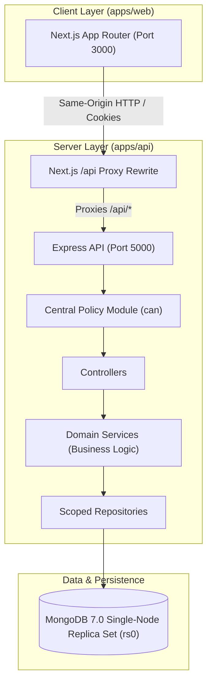
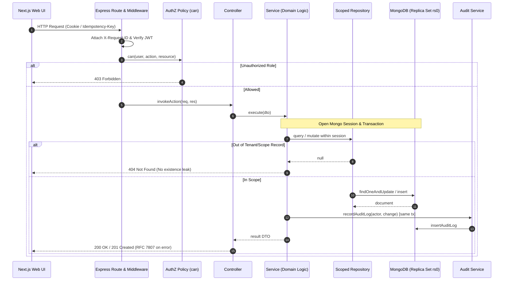

# System Architecture

## 1. High-Level Architecture (C4-Lite System Context)

The School Management System is structured as a **modular monolith** with clear domain boundaries, layered separation of concerns, and shared type contracts between client and server.



---

## 2. Request Lifecycle & Layering

All backend operations strictly adhere to unidirectional flow:
```
Routes → Middleware (Auth/Request-ID) → Policy (AuthZ) → Controller → Service (Transaction) → Repository → MongoDB
```



---

## 3. Why a Modular Monolith?

1. **Transactional Integrity:** Academic and financial workflows (e.g. invoice generation with ledger entries, attendance bulk recording, exam locking with snapshots) require ACID guarantees across related records. A single MongoDB replica set connection avoids distributed transaction overhead (2PC/Sagas).
2. **Operational Simplicity:** A single deployable unit on free cloud hosting (Render for API, Vercel for Web, Atlas for DB) eliminates multi-service network latency, orchestration complexity, and distributed tracing costs.
3. **Traceability:** Student evaluation requires tracing requests from UI to database within minutes. Strict repository layering guarantees predictable debugging.

---

## 4. Concurrency & Data Integrity Strategy

| Business Rule | Integrity Mechanism | Automated Verification |
|---|---|---|
| **A1: Teacher Scoping** | Repository-level scoped queries automatically filter by assigned section/subject; returns `404` for out-of-scope resources. | `apps/api/tests/integration/attendance-access.test.ts` |
| **A2: Attendance Deduplication** | Unique compound index `(student_id, date, session)` + transactional idempotent bulk upsert (`PUT`). | Concurrency test with 50 parallel requests |
| **A3: Immutable Exam Results** | Grading scheme configuration is copied into `exams.grading_snapshot` upon transition to `LOCKED`. Pure-function calculations with integer hundredths. | Hand-computed unit test suite with boundary and absent conditions |
| **A4: Guardian Isolation** | Repository filters match student against verified guardian links in JWT token scope; returns `404` for unlinked students. | Multi-child switching and cross-family URL test |
| **A5: Financial Ledger Balance** | Append-only ledger; outstanding balances calculated as `invoiced - paid = sum(ledger)`. Invoices use version-checked atomic updates. | Concurrency payment test + ledger reconciliation check |

